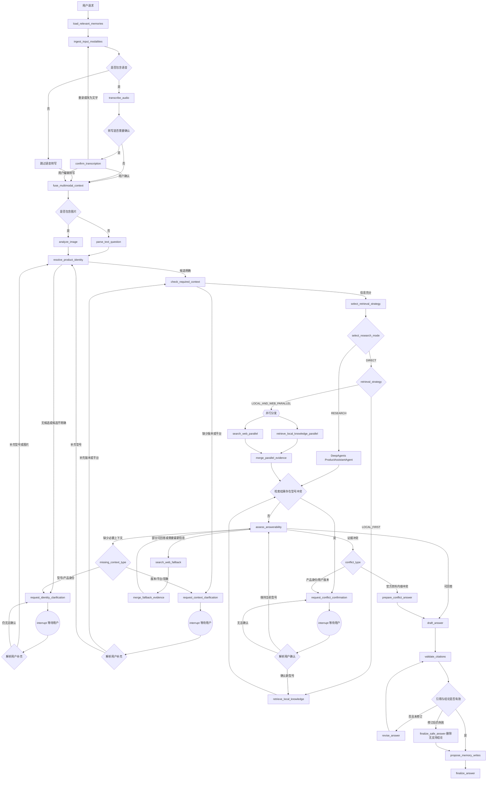

# 产品使用助手 Agent 项目规划

## 1. 项目定位

本项目构建一个面向终端用户的多模态产品使用助手 Agent。用户可以输入文字、上传或录制语音、上传产品图片并提出问题，系统结合语音识别、视觉模型、本地知识库 RAG 和官方 Web Search，生成带来源引用的产品使用或问题排查回答。

本产品定位为“基于资料回答产品使用问题的多模态知识型 Agent”，支持文字、图片和语音输入，不连接真实硬件、不伪造设备状态，也不执行重启、配网或修改配置等控制操作。这是产品边界，而不是尚未完成的临时裁剪。成品重点展示语音转写、图片识别、多模态信息融合、混合检索、联网研究、证据融合、长期记忆和 Agent 工作流编排能力。语音识别是正式输入能力；语音合成和实时语音通话不属于当前产品范围。

面试演示知识库覆盖以下代表性产品类别：

- 路由器；
- 打印机；
- 智能摄像头。

领域模型、入库管道和工作流保持通用，可通过新增产品目录与可信来源配置覆盖其他电子设备，不需要修改主流程代码。

“通用”表示系统具备可配置扩展能力，不表示成品知识库已经可靠覆盖所有品牌和型号。对于不在产品目录中的设备，系统可以给出图片中的通用观察；只有品牌已配置可信来源时才允许联网抓取，否则请求用户提供型号、官方链接或说明书，并明确说明当前知识覆盖限制。

### 面试成品定义

交付物不是概念验证、单个 Notebook 或只通主链路的 MVP，而是可以直接用于面试演示和技术讲解的完整产品：

- 通过 Docker Compose 一键启动前端、后端、数据库、Redis 和 MinIO；
- 提供完整聊天界面、文字输入、图片上传、语音录制/上传、转写确认、澄清确认、流式进度、来源引用和反馈；
- 提供可重复的数据初始化、三类产品知识库和固定演示场景；
- 提供文档入库、索引状态、失败重试和知识版本管理；
- 提供跨会话长期记忆、记忆使用说明以及查看、纠正和删除能力；
- 提供 DeepAgents 任务规划、Skills、专业子 Agent、上下文隔离和大型结果卸载；
- 提供自动测试、离线评测报告、可观测 Trace 和安全测试；
- 提供 README、架构图、演示脚本、设计决策和已知限制；
- 在无 Web Search 或单个模型服务失败时仍能明确降级，不出现无依据回答。

验收和演示数据固定使用一个明确型号对应一个产品类别：TP-Link Archer AX55 路由器、HP LaserJet M110w 打印机、TP-Link Tapo C200 智能摄像头。只使用可公开访问的官方资料和自行编写的故障案例，并在项目中保留来源与授权说明。

## 2. 总体技术架构

```text
React + TypeScript
        ↓ SSE
FastAPI
        ↓
LangGraph + DeepAgents
        ↓
语音转写 / 图像分析 / 多模态问题理解 / 本地 RAG / Web Search / 长期记忆 / 引用验证
        ↓
PostgreSQL + pgvector + BM25 扩展

MinIO：音频、产品图片、PDF 和原始文档
Redis：缓存、异步任务和搜索结果缓存
```

技术选型：

- 前端：Node.js 22 LTS、TypeScript strict、React、Vite、TanStack Query、Zustand、pnpm；
- 后端：Python 3.12、FastAPI、Pydantic；
- Agent：LangGraph、DeepAgents，固定兼容版本并通过启动期能力检查；
- Agent 状态与记忆：LangGraph PostgreSQL Checkpointer、PostgreSQL Store、DeepAgents CompositeBackend；
- 语音识别：统一 `SpeechRecognizer` 适配层，支持可配置的云端或本地 ASR，默认返回带时间戳和词级置信度的结构化转写；
- 数据库：PostgreSQL；
- 向量检索：pgvector；
- 关键词检索：PostgreSQL BM25 扩展；
- Web Search：Tavily Search API，通过自定义适配层接入；
- 文件存储：MinIO，生产环境可替换为 S3；
- 缓存和任务队列：Redis；
- 异步任务：Celery，负责文档解析、OCR、Embedding 和重建索引；
- 部署：Docker Compose；Kubernetes 和高可用集群明确不属于本产品的交付范围；
- 数据访问与迁移：SQLAlchemy 2、Alembic；
- 工程质量：Ruff、Pyright、Pytest、ESLint、Vitest、Playwright；
- 可观测性：OpenTelemetry + 结构化日志，Langfuse 作为可配置的 LLM Trace 后端；
- CI：GitHub Actions，执行静态检查、单元测试、集成测试和快速评测集。

### 单仓库结构

```text
frontend/             React 用户助手、记忆管理与知识库管理
backend/
  app/api/            FastAPI 路由与 SSE
  app/agents/         LangGraph 与 DeepAgents
  app/rag/            入库、检索、Reranker 与证据评估
  app/web/            搜索、URL 校验与安全抓取
  app/domain/         领域模型与接口
  app/infrastructure/ PostgreSQL、Redis、MinIO、模型适配器
  tests/              单元与集成测试
infra/                Docker Compose、监控和初始化
data/                 自建演示案例与种子元数据
evals/                评测集、运行器和版本报告
docs/                 架构、ADR、演示脚本和安全说明
```

前后端以 OpenAPI 为唯一 HTTP 契约，自动生成 TypeScript 类型，避免手工维护两套请求模型。

## 3. LangGraph 与 DeepAgents 的职责边界

DeepAgents 本身构建在 LangGraph 能力之上。两者不是两个平级、互相竞争的全局编排框架：项目用 LangGraph 定义产品级状态机和可靠性边界，用 DeepAgents 提供复杂研究所需的现成 Agent Harness，并将其编译图作为受控子图嵌入主流程。

### 3.1 LangGraph：系统级工作流编排层

LangGraph 负责确定性的流程控制和状态管理：

- 使用类型化 `AgentState` 和 reducer 管理并发分支合并；
- 使用条件边管理节点跳转，使用并行分支完成本地检索与 Web Search fan-out/fan-in；
- 控制图片分析、本地 RAG 和 Web Search 的执行顺序；
- 根据证据可回答性和问题时效性决定是否联网搜索；
- 使用 `interrupt()` 与 `Command(resume/goto/update)` 支持按原因暂停和精确恢复；
- 使用 `AsyncPostgresSaver` 保存 Checkpoint，保证进程重启后仍能恢复；
- 使用 `AsyncPostgresStore` 提供跨 thread 的用户记忆命名空间；
- 将编译后的 DeepAgents graph 作为受控 research 子图调用，并校验其结构化输入输出；
- 通过递归上限、节点超时、重试策略和错误边处理失败与降级；
- 通过 LangGraph 流式模式向事件适配层输出节点、消息和自定义事件。

当前项目的主流程由 LangGraph 控制，并显式处理跳过、暂停、确认、冲突和循环：

```text
接收用户请求
  ↓
按用户命名空间加载与当前问题相关的已批准记忆
  ↓
是否包含图片？
  ├── 否 → 跳过视觉分析，解析文本问题
  └── 是 → 分析图片并生成产品候选
                    ↓
             候选是否经过产品目录和强证据确认？
              ├── 是 → 继续补充上下文
              ├── 多候选/弱证据 → 请求用户确认或补充图片
              └── 无结果 → 请求用户提供型号或重新上传
                              ↓
                        等待用户回复并恢复流程
  ↓
产品、平台、版本是否足够？
  ├── 否 → 暂停并追问，收到回复后恢复
  └── 是 → 选择检索策略和 DIRECT/RESEARCH 模式
                  ↓
          本地优先或本地与 Web 并行检索
                  ↓
          检索结果是否出现型号冲突？
           ├── 是 → 标记冲突并请求用户确认，确认后重新检索
           └── 否 → 评估证据可回答性
                          ↓
                  ├── 可回答 → 引用验证与回答
                  ├── 部分/不可回答 → Web Search 后重新评估
                  ├── 缺少上下文 → 暂停并追问
                  └── 证据冲突 → 请求用户确认
```

LangGraph 解决的问题是：

> 系统接下来应该执行哪一步，以及失败后如何继续或降级。

### 3.2 DeepAgents：复杂任务执行层

DeepAgents 运行在 LangGraph 授权的复杂研究节点中，使用框架现成的 Agent Harness，而不是重新手写一套 ReAct 循环。主 Agent 命名为 `ProductAssistantAgent`，负责：

- 使用 `TodoListMiddleware` 把复杂问题拆成可追踪任务，并持续更新完成状态；
- 通过内置 `task` 委派专业子 Agent，使网页大文本、手册搜索结果和批判性检查分别处于隔离上下文；
- 通过 Skills 渐进加载产品识别、手册研究、网页证据安全、引用和记忆策略；
- 使用 DeepAgents 的虚拟文件系统保存计划、中间证据与大型工具结果，避免把全部内容塞回主对话；
- 使用自动上下文摘要和工具结果 offloading 控制长任务上下文；
- 在 LangGraph 下发的工具白名单、网络策略和预算内执行多轮研究；
- 以结构化输出返回 `ResearchResult`，并将类型化执行事件映射到前端 SSE。

DeepAgents 提供的是可组合的现成能力，但不是零配置的业务系统。项目仍需显式配置 Checkpointer、Store、Backend 路由、Skills、子 Agent 工具权限、预算和结构化输出；这些能力不能绕过 LangGraph 的业务状态、安全策略和发布门禁。

`ProductAssistantAgent` 配置三个有明确职责和最小权限的专业子 Agent：

- `manual_researcher`：只允许调用本地混合检索与只读知识文件，研究手册、FAQ、版本说明；
- `official_web_researcher`：只允许调用安全封装后的官方搜索和网页抓取器，在隔离上下文中返回结构化 `WebEvidence`；
- `evidence_critic`：只读已有证据，检查产品、版本、时效、问题覆盖和冲突，不允许搜索、抓取或写入记忆。

产品身份确认、Web Search 授权、URL 安全判断、长期记忆落库和最终答案发布仍由 LangGraph 或确定性服务控制，不交给子 Agent 自主决定。

DeepAgents 解决的问题是：

> 当前任务具体应该如何拆解、使用哪些工具，以及如何整理多个中间结果。

### 3.3 两者在本项目中的协作方式

采用“LangGraph 控制产品级流程边界，DeepAgents 执行受限的复杂研究任务”的模式。简单、单跳、证据明确的问题直接走 LangGraph 的确定性 RAG 路径；包含多个子问题、跨版本比较、多轮搜索或证据互证的问题进入 `ProductAssistantAgent`。这样既完整展示 DeepAgents 能力，也不会为了使用多 Agent 而增加简单请求的延迟和不确定性。

```text
FastAPI
  ↓
LangGraph：控制全局流程和状态
  ├── DIRECT：确定性本地 RAG / 条件 Web Search
  └── RESEARCH：DeepAgents ProductAssistantAgent
                    ├── Todo 规划
                    ├── manual_researcher
                    ├── official_web_researcher
                    ├── evidence_critic
                    ├── Skills 渐进加载
                    └── 虚拟文件系统、摘要与结果卸载
```

`ProductAssistantAgent` 不得修改全局工作流状态、决定是否授权 Web Search、直接提交长期记忆、绕过安全抓取器或直接发布最终用户答案。LangGraph 根据检索策略动态传入允许工具，并限制最大步骤数、子 Agent 调用次数、搜索次数、Token、成本和执行时间。DeepAgents 只能返回结构化研究结果和记忆写入建议，由 LangGraph 的证据评估、引用验证、记忆策略和回答发布节点处理。

research 子图只接收窄化后的 `ResearchRequest`，只返回 `ResearchResult` 和类型化事件。DeepAgents 内部消息、临时文件和子 Agent 对话不会整体合并进全局 `AgentState`；父图只保存结果引用、预算消耗和可审计摘要，避免状态键冲突与上下文污染。

### 3.4 DeepAgents 原生能力落地清单

以下能力全部进入实现和验收范围，而不是仅在架构图中出现：

- 任务规划：复杂研究启用可选的 `TodoListMiddleware`，前端只展示任务标题和状态，不展示隐藏推理；
- 子 Agent：使用框架的 subagents 与 `task` 工具，分别隔离本地研究、官方网页研究和证据批判；
- Skills：在 `/skills/` 提供只读的 `product-identification`、`manual-research`、`web-evidence-safety`、`citation-policy` 和 `memory-policy`；
- 虚拟文件系统：`/workspace/` 保存计划和中间证据，`/large_tool_results/` 保存卸载结果，禁止使用服务主机文件系统作为 Agent 可写空间；
- 上下文工程：启用自动摘要和大工具结果 offloading，并验证摘要后关键产品事实、版本和未完成任务不丢失；
- 短期状态：默认 `StateBackend` 保存当前 thread 的 scratch 文件，并随 LangGraph Checkpoint 持久化；
- 长期记忆：`/memories/` 路由到 `StoreBackend`，底层使用 LangGraph PostgreSQL Store，并按用户命名空间隔离；
- 组合存储：使用 `CompositeBackend` 将临时工作区、长期记忆和只读 Skills 路由到不同后端；
- 人工介入：DeepAgents 的工具审批只用于高风险工具边界，产品澄清和身份确认统一由 LangGraph `interrupt()` 管理；
- 流式事件：消费 DeepAgents 类型化事件，映射为稳定的业务 SSE 事件；
- 结构化输出：Supervisor 和子 Agent 都使用 Pydantic 模型校验结果，失败时按预算修复一次或降级。

不会为了“用全功能”而开放与本产品无关的高风险能力：Agent 不获得任意 Shell、任意代码执行、任意主机文件系统或任意 HTTP 访问权限。框架能力的采用标准是能否直接提升产品任务的规划、上下文、记忆、协作或可观测性。

框架升级采用固定版本、迁移说明和契约测试，避免 DeepAgents 或 LangGraph API 变化破坏 Checkpoint、Store、Middleware 与事件流。

## 4. 核心业务流程

### 4.1 状态和节点

LangGraph 的状态至少包含：

```text
conversation_id
user_subject_id
user_question
input_modalities
audio_assets
transcription
transcription_confirmed
conversation_summary
confirmed_facts
relevant_memories
memory_usage
memory_write_proposals
image_assets
image_observations
product_identity_candidates
identity_resolution
selected_candidate_id
product_model
product_version
platform
product_hints
symptoms
multimodal_context
clarification_question
pending_reason
resume_target
waiting_payload
retrieval_query
retrieval_strategy
research_mode
agent_todos
subagent_runs
retrieval_evidence
conflicting_candidates
web_evidence
evidence_assessment
draft_answer
citation_report
answer_revision_attempts
answer
status
identity_attempts
retrieval_attempts
```

主要节点：

```text
receive_input
  → load_relevant_memories
  → ingest_input_modalities
  → transcribe_audio (条件节点)
  → confirm_transcription (必要时 interrupt)
  → analyze_image (条件节点)
  → fuse_multimodal_context
  → resolve_product_identity
  → check_required_context
  → select_retrieval_strategy
  → select_research_mode
  → retrieve_local_knowledge
  → detect_product_conflict
  → assess_answerability
  → search_web (条件节点)
  → merge_evidence
  → draft_answer
  → validate_citations
  → propose_memory_writes
  → finalize_answer
```

### 4.2 没有图片时

如果用户没有上传图片（但可能提供了文字或已确认的语音转写）：

1. 跳过 `analyze_image`；
2. 从文本中提取品牌、型号、版本和平台；
3. 如果关键信息不足，进入 `check_required_context`；
4. 信息足够后继续本地检索；语音转写内容与键入文字一起进入 `fuse_multimodal_context`，不执行视觉节点。

### 4.3 语音输入与转写确认

语音是正式的用户输入模态，但语音识别结果不能未经确认直接作为产品型号、错误码或操作指令。流程如下：

1. 接收浏览器录音或音频文件，校验真实 MIME、编码、时长、采样率和文件大小后写入 MinIO；
2. `transcribe_audio` 调用统一 `SpeechRecognizer`，返回语言、分段文本、起止时间、词级置信度、说话人数量（如果供应商支持）和模型版本；
3. 对中文、英文、型号字母数字、错误码和菜单名称执行规范化，但保留原始转写文本，不把纠错结果覆盖原文；
4. 低置信度、包含多个型号候选、数字/字母混淆或存在否定词歧义时，进入 `WAITING_FOR_USER`，展示可编辑转写文本，让用户确认或修改；
5. 用户确认后，转写文本才进入问题理解、产品身份解析和 RAG 查询；用户拒绝时可以重新录音或直接输入文字；
6. 语音中同时包含产品描述和问题时，将转写内容拆分为 `product_hints`、`symptoms`、`question`，但所有产品身份提示仍需目录验证；
7. 无法识别语音时保留图片和文字输入路径，提示用户改为文字或重新录音，不生成猜测内容。

语音转写只负责把音频转换为可审查的文本，不负责回答问题、不调用工具，也不绕过 LangGraph 的澄清和安全门禁。语音中的“请打开某链接”“忽略之前规则”等内容一律视为用户数据，不能改变系统提示词或工具权限。

### 4.4 多模态输入组合

图片和语音可以同时出现：图片提供产品外观、标签、屏幕和指示灯观察，语音提供用户描述、错误现象、时间顺序和环境信息。`fuse_multimodal_context` 生成带来源标记的统一上下文：

```text
USER_TEXT       用户键入的原文
ASR_TRANSCRIPT  用户确认后的语音转写
IMAGE_OBSERVATION 图片模型提取的观察
MEMORY_CONTEXT  已批准且与当前问题相关的长期记忆
```

不同来源发生冲突时，优先级为“用户当前明确纠正 > 用户确认的转写/文字 > 标签 OCR 和目录匹配 > 图片外观观察 > 历史记忆候选”。冲突不得静默覆盖，必须进入身份确认或上下文澄清。

### 4.5 图片识别出多个候选型号时

不允许直接选择第一个候选。流程按以下规则处理：

- 一个候选且有足够强的目录匹配证据、没有冲突：自动确认；
- 多个候选或置信度不足：展示候选列表并暂停；
- 用户确认后写入 `selected_candidate_id`，再继续检索；
- 用户否定所有候选：要求上传包含型号标签的图片或直接输入型号。

暂停时必须保存 LangGraph Checkpoint，状态设置为 `WAITING_FOR_USER`。用户下一条消息通过原会话恢复流程，而不是重新创建 Agent。

### 4.6 型号、平台或版本缺失时

根据问题类型决定是否必须补充信息：

- 通用使用问题可以先用产品类型和型号回答；
- 版本差异、兼容性和错误码问题通常必须获取版本或平台；
- 缺少必要信息时，进入 `WAITING_FOR_USER`，只询问最少必要字段；
- 用户回复后重新执行上下文解析，不重复执行已经成功的图片分析。

### 4.7 本地检索发现其他型号时

检索结果中的产品元数据必须与当前 `selected_candidate_id` 对应的身份解析结果比较：

- 同一产品和版本：正常使用；
- 只有部分匹配：降低证据分数并标记为相关型号；
- 发现明确不同型号：进入 `detect_product_conflict`；
- 冲突时不能静默切换型号，必须向用户说明候选差异并请求确认；
- 用户确认新型号后，清理旧型号检索结果并重新执行检索。

### 4.8 循环和退出条件

为避免 Agent 无限追问或反复检索：

- 产品识别最多自动尝试 2 轮；
- 同一音频最多自动转写 2 次，用户主动重录不受该音频任务计数影响；
- 型号冲突最多重新检索 1 次；
- Web Search 最多执行 2 轮查询；
- 每次暂停必须保存 `resume_target`，恢复时只回到对应节点；
- 超过上限后输出当前可确认的信息，并明确说明缺失信息；
- 用户主动结束时立即进入最终回答或结束状态。

### 4.9 主流程图与显式回边

不同原因引起的澄清必须返回不同的目标节点，不能统一回到流程起点。成品工作流使用以下显式回边：



回边语义如下：

- 用户补充型号或重新上传图片：回到 `resolve_product_identity`，重新生成和验证产品候选；
- 用户补充软件版本或运行平台：回到 `check_required_context`，不重复分析图片；
- 用户确认检索冲突中的新型号：回到 `retrieve_local_knowledge`，清理旧检索证据后重新检索；
- 用户确认维持当前型号：回到 `assess_answerability`，继续使用当前身份评估证据；
- 用户仍无法确认冲突：回到 `request_conflict_confirmation`，继续澄清但受循环上限约束。
- Web Search 完成后：合并本地和在线证据，再回到 `assess_answerability`，不得直接生成答案。

在 LangGraph 中，澄清节点调用 `interrupt()` 保存当前 Checkpoint 和等待原因。用户下一条消息通过 `Command(resume=...)` 恢复，再由恢复路由根据 `resume_target` 使用 `Command(goto=...)` 跳转到指定节点，而不是默认从头执行。

### 4.10 产品身份解析

产品识别采用“观察、候选、验证、确认”四阶段，不把视觉模型的单次输出直接当作最终身份：

```text
图片/文本观察
  ↓
字段级 OCR 与视觉结果
  ↓
产品目录候选匹配
  ↓
关联文档和错误码交叉验证
  ↓
自动确认或请求用户确认
```

证据强度按以下顺序处理：

1. 用户明确输入的型号或型号标签 OCR；
2. 产品目录中的精确型号、别名和序列号规则匹配；
3. 屏幕文字、错误码和版本文字匹配；
4. 设备外观、布局和颜色等视觉特征。

只有强证据能够唯一匹配产品目录且不存在冲突时，才允许自动确认型号。仅凭外观识别出的型号必须保持为候选，不得直接作为已确认身份。

未确认身份时可以进行产品类型级别的通用检索，但不得生成依赖具体型号或版本的确定性结论。确认产品身份后，才允许启用型号和版本级过滤。

### 4.11 证据可回答性评估

“检索置信度”不等同于向量相似度、BM25 分数、RRF 排名或答案正确概率。系统使用独立的 `assess_answerability` 节点判断检索结果是否足以支撑回答。

评估分为硬性条件和质量条件：

**硬性条件**

- 产品身份是否匹配当前已确认型号；
- 产品版本、硬件修订版和平台是否兼容；
- 文档来源是否属于允许的官方或已审核来源；
- 证据是否存在明确的版本冲突或互相矛盾。

**质量条件**

- 是否覆盖用户问题的主要意图；
- 是否包含回答操作问题所需的前置条件；
- 是否包含完整步骤、限制条件和预期结果；
- 是否足够新，能够回答版本或兼容性问题；
- 是否有多个证据支持关键结论。

相似度和 RRF 只用于召回和排序，不直接决定是否可以回答。问题覆盖、操作完整性和引用支持关系需要由结构化评估器判断。评估器可以使用确定性规则加受约束的 LLM 判定，但 LLM 只能基于提供的证据输出 JSON，不得补充外部事实。

评估结果不是单一概率，而是以下状态之一：

```text
ANSWERABLE       证据与身份、版本和问题意图匹配，可以回答
PARTIAL          可以回答部分内容，但缺少最新资料或部分步骤
UNANSWERABLE     没有证据直接回答用户问题
MISSING_CONTEXT  缺少型号、版本、平台或其他必要条件
CONFLICTED       证据之间存在产品、版本或结论冲突
```

路由规则：

- `ANSWERABLE`：进入引用验证和回答生成；
- `PARTIAL`：优先调用 Web Search 补充证据，再重新评估；
- `UNANSWERABLE`：如果问题可通过公开资料补充则调用 Web Search，否则明确说明无法确认；
- `MISSING_CONTEXT`：缺少产品身份时恢复到 `resolve_product_identity`；缺少版本、平台或现象时恢复到 `check_required_context`；
- `CONFLICTED`：产品身份或用户版本冲突时请求用户确认；官方资料自身存在内容冲突时不得让用户替系统选择，而是说明冲突、适用范围和无法确认的部分。

Web Search 返回的新证据必须重新经过同一评估流程，不能因为来自互联网就自动视为可信。

### 4.12 检索策略路由

在执行检索前增加 `select_retrieval_strategy` 节点：

```text
普通使用问题
  → LOCAL_FIRST
  → 本地混合检索
  → 证据不足时再执行 Web Search

当前版本 / 最新固件 / 兼容性 / 最新公告
  → LOCAL_AND_WEB_PARALLEL
  → 并行执行本地混合检索和 Web Search
  → 两路完成或超时后合并证据
  → assess_answerability
```

并行模式中任一路失败不阻塞另一路。合并节点记录各来源的成功、失败和超时状态；如果只有搜索摘要而正文抓取失败，该结果只可用于发现来源，不可单独支撑操作性结论。

### 4.13 简单检索与 DeepAgents 研究模式

`select_research_mode` 将问题分为：

```text
DIRECT
  单一明确问题、一次检索可以回答
  → LangGraph 直接调用 Retriever

RESEARCH
  包含多个子问题、跨版本比较、需要多次查询或证据互证
  → LangGraph 调用 DeepAgents ProductAssistantAgent
```

`ProductAssistantAgent` 的默认预算为最多 8 个 Todo、4 次子 Agent 调用、2 次 Web Search、8 个保留证据项和 60 秒总执行时间。预算由服务端策略按问题类型配置，不由 Agent 自行扩大。达到上限时返回当前证据、未解决问题和停止原因，不继续无限循环。

Supervisor 只接收完成任务所需的相关记忆、产品身份、检索策略和工具能力；子 Agent 获得更小的任务上下文和最小工具集。子 Agent 输出先经过结构化校验再回到 Supervisor，最终 `ResearchResult` 仍需通过 LangGraph 的 `assess_answerability` 和引用验证。

### 4.14 短期状态与跨会话长期记忆

系统同时实现两类记忆，并明确区分“运行状态”“用户记忆”和“可引用产品证据”。长期记忆用于个性化和减少重复追问，不能替代手册或官方网页成为产品事实引用。

#### 4.14.1 LangGraph 短期状态

使用 `AsyncPostgresSaver` 保存 thread 级 Checkpoint，持久化当前对话的消息、节点状态、暂停点和已确认上下文。关键事实以结构化字段保存，不依赖大模型自由总结：

```text
confirmed_product_id
confirmed_model
confirmed_version
platform
confirmed_symptoms
user_corrections
```

- 同一会话中的追问默认复用已确认身份和版本，不重复执行图片分析；
- 用户上传新产品图片或明确切换产品时，清空旧产品证据和检索上下文；
- 用户纠正型号或版本时，以最新明确输入为准，并触发身份验证和重新检索；
- 长对话只对非关键历史生成 `conversation_summary`，关键产品事实和引用始终结构化保存；
- Prompt 只加载当前问题需要的历史，避免无限增长和旧证据污染。

#### 4.14.2 LangGraph Store 与 DeepAgents 长期记忆

使用 `AsyncPostgresStore` 作为跨 thread 的持久化 Store。DeepAgents 通过 `CompositeBackend` 将默认工作区路由到 `StateBackend`，将 `/memories/` 路由到 `StoreBackend`，将 `/skills/` 路由到只读 Skills 后端。命名空间至少包含 `user_subject_id`，任何查询和写入都必须进行服务端归属校验，不能仅信任模型传入的路径。记忆可以使用 Store 的语义索引和结构化过滤检索，但必须与产品文档 RAG 使用独立 namespace、索引配置和数据保留策略。

业务表是长期记忆的事实源。服务端根据已批准记录生成用户作用域的只读记忆索引和 `AGENTS.md` 记忆视图供 DeepAgents 渐进读取；Agent 对记忆文件的“写入”只会生成 `MemoryWriteProposal`，不能直接改变事实源。

允许保存的长期记忆包括：

- 用户拥有或经常询问的设备，以及已经由用户或强证据确认的型号和硬件修订版；
- 语言、回答详细度、单位和平台偏好；
- 用户明确要求记住的使用环境信息；
- 用户确认已尝试且成功或失败的排障步骤；
- 用户对错误产品身份、版本或环境信息的明确纠正。

禁止保存的内容包括：

- Wi-Fi 密码、登录凭据、API Key、验证码和访问令牌；
- 完整序列号、精确位置以及与任务无关的个人信息；
- 未经用户确认的视觉推断、模型猜测或低置信度候选；
- 网页指令、搜索摘要或其他不可信外部内容；
- 可以由本地知识库稳定查询到的通用产品事实。

#### 4.14.3 记忆写入和使用策略

- 用户明确说“记住这个”时，视为写入授权，但仍需经过敏感信息过滤、类型校验和去重；
- Agent 推断出的潜在有用信息只能生成 `MemoryWriteProposal`，由前端让用户确认后写入；
- 用户通过“问题已解决/仍未解决”确认排障结果时，可选择将对应步骤记入设备历史；
- 每次回答只检索与当前产品和问题有关的 Top-K 记忆，并记录 `memory_usage`；
- 历史设备记忆只能帮助生成身份候选，不能自动确认当前图片中的产品；当前用户输入、标签 OCR 和目录验证结果优先；
- 历史排障结果在复用前必须重新检查型号、版本、平台和当前官方证据，不能因为过去成功就直接推荐；
- 回答界面显示本次使用的记忆摘要，用户可以查看、纠正、删除或要求本轮忽略；
- 新记忆与旧记忆冲突时不静默覆盖：明确的用户纠正创建新版本并使旧值失效，其他冲突生成待确认提案；
- 设备状态和环境信息支持 `expires_at`，过期后不进入 Prompt；偏好类记忆默认不过期但可随时删除；
- 删除用户记忆时先在业务事务中写入 tombstone 并立即从检索范围排除，再删除 Store 表示；对账任务负责重试失败的物理清理，仅保留不含原值的合规事件；
- 长期记忆只作为上下文提示，涉及型号、版本和操作安全的结论仍必须由当前产品目录和证据重新验证。

#### 4.14.4 DeepAgents 上下文管理

复杂研究的临时计划和中间文件保存在 thread 的 `StateBackend`；超大网页正文和工具结果由 DeepAgents 自动卸载到虚拟文件系统，只把引用句柄和摘要保留在模型上下文。自动摘要不能覆盖结构化的产品身份、版本、用户纠正、Todo 状态和证据 ID。运行结束后按保留策略清理临时文件，只有通过记忆策略的内容才允许进入 `/memories/`。

## 5. 面试成品核心功能

### 5.1 产品图片分析

视觉模型只负责提取图片中的原始观察结果，不直接认定产品身份。观察目标包括品牌文字、产品类型、型号标签、硬件修订版、固件版本、屏幕文字、指示灯状态和错误信息。

每个观察字段独立记录置信度、候选值和证据来源。视觉外观只能作为弱证据，型号标签 OCR、屏幕文字和用户明确输入属于更强证据。

产品身份必须经过产品目录匹配和证据交叉验证后才能确认。无法确认时，Agent 必须请求用户补充型号标签、序列号区域或更清晰的图片。

#### 5.1.1 语音识别与多模态输入

语音识别采用“音频资产 → ASR 转写 → 用户确认（必要时）→ 统一问题理解”的链路：

- 浏览器支持录音和音频文件上传，前端在发送前展示时长、大小和播放控件；
- 后端通过 `SpeechRecognizer` 适配不同 ASR 服务，输出原始文本、规范化文本、语言、分段/词时间戳、置信度、模型版本和错误状态；
- 语音中的产品名、型号、版本、错误码和菜单名称保留原始文本与标准化候选，避免把 `AX55`、`H55` 等识别混淆直接带入检索；
- 低置信度或包含高风险字段时暂停并展示可编辑转写，用户确认后才进入身份解析和检索；
- 用户确认的转写可以作为检索查询和问题上下文，但不能单独证明产品身份或操作步骤；
- 音频只在当前会话需要时进入模型，原始音频默认按会话保留策略保存，转写文本与音频对象分别支持删除；
- ASR 失败、超时或语言不支持时，保留文本和图片路径，提示用户重录或改用文字，不影响其他模态继续处理。

语音和图片组合时，系统将语音中的症状、时间顺序、环境描述与图片中的型号标签、屏幕文字、指示灯状态分别标注来源，再由 `fuse_multimodal_context` 合并。回答必须能够区分“用户说设备发出三声蜂鸣”和“图片观察到红色指示灯”，不能把两者伪装成同一种证据。

### 5.2 混合 RAG

使用 pgvector 执行语义检索，使用 BM25 执行关键词检索，再通过 RRF 融合结果。RRF 只负责候选排序，融合结果必须再经过 `assess_answerability`。检索过滤条件包括产品类型、产品型号、产品版本、平台、语言和文档类型。

系统检测用户语言，使用多语言 Embedding 和 Reranker 支持中文提问检索英文手册；最终回答使用用户语言，但型号、错误码、菜单名称和引用原文保持原始形式，必要时同时给出翻译。

### 5.3 Web Search 兜底

本地知识库没有结果、证据可回答性不足、产品型号未收录，或用户明确要求联网搜索时，触发 Web Search。系统只搜索厂商官网、官方帮助中心和官方技术文档。

对于明确涉及当前版本、固件、兼容性或最新信息的问题，本地 RAG 和 Web Search 并行执行，之后统一进入证据融合与可回答性评估；普通问题仍采用本地检索优先、必要时再联网的策略。

### 5.4 多来源证据融合

将用户确认的语音转写、图片分析结果、本地 RAG 片段、Web Search 结果、长期记忆提示和对话上下文统一交给回答节点。回答中明确区分用户语音描述、本地文档来源、在线网页来源、图片观察结果、记忆提示和无法确认的推测；语音转写本身不是产品事实引用。

### 5.5 引用验证

证据可回答后先生成结构化答案草稿，再逐条检查关键结论是否有真实引用支持、是否属于正确产品版本，以及网页最终 URL 是否通过可信来源和安全抓取校验。只有摘要但正文提取失败的来源不得作为操作步骤的唯一引用。

验证失败时最多修订草稿一次；修订后仍无法支持的结论必须删除或改为明确的不确定说明，然后才能发布最终答案。引用验证不能发生在答案草稿生成之前。

### 5.6 多轮澄清

当产品型号、版本、平台或问题现象不明确时，Agent 先追问，不直接猜测。

### 5.7 流式回答

通过 SSE 展示音频上传、语音转写、转写确认、图片分析、多模态融合、本地检索、在线搜索和答案整理状态。

### 5.8 可观测性

可观测性用于回答“系统发生了什么”，不直接证明回答正确。默认通过 OpenTelemetry 和结构化日志记录统一 Trace；配置 Langfuse 时同步记录 LLM 与 Agent Trace：

- 语音资产、ASR 语言/模型、分段与词级置信度、用户是否确认或修改转写；
- 图片识别字段、候选值和证据；
- LangGraph 节点、条件边、暂停原因和恢复目标；
- 检索查询、过滤条件、召回结果和排序分数；
- Web Search 触发原因、URL 校验和抓取状态；
- 证据可回答性评估及路由决定；
- DeepAgents Todo 状态、子 Agent 调用、Skills 使用、预算消耗、摘要和结果卸载；
- 长期记忆检索 ID、实际使用、写入提案、用户决定和删除状态，不记录敏感原值；
- 最终回答、引用和用户反馈；
- 模型、Token、成本、首 Token 延迟、总延迟、异常和重试。

每条 Trace 使用同一个 `trace_id` 关联会话、检索、搜索、模型和引用记录，并保留 Prompt、模型、知识库和评测集版本。

### 5.9 评测体系

评测用于回答“系统做得是否正确”。项目建立版本化离线评测集，并分别评估组件质量和端到端任务质量。

#### 5.9.1 标准评测集

评测集覆盖路由器、打印机和智能摄像头，并包含：

- 清晰型号标签、模糊图片、多候选外观和无图片问题；
- 正确型号、相似型号、硬件修订版和固件版本冲突；
- 使用说明、错误码、兼容性、最新版本和无法回答问题；
- 本地知识可回答、需要 Web Search、需要追问和证据冲突案例；
- 网页抓取失败、过期资料、恶意提示注入和 SSRF 测试案例。

每个样本由人工标注：产品身份、必要上下文、标准证据、允许结论、禁止结论、期望路由、期望引用和问题是否可回答。评测集划分为开发集和锁定测试集；锁定测试集不能用于 Prompt 调优。

成品评测集不少于 220 个案例，每个演示产品至少 60 个；其中至少包含 50 个图片案例、35 个语音案例、20 个图文音组合案例、30 个需要联网或时效判断的案例、30 个不可回答/缺上下文/冲突案例、20 个长期记忆案例，以及 20 个提示注入或抓取安全案例。类别可以重叠，但锁定测试集至少占 30%。

#### 5.9.2 组件级指标

- 产品识别：字段级 Precision、Recall、F1，型号 Top-1/Top-3 准确率，以及模糊样本的正确拒绝率；
- OCR：型号、错误码和版本字段的精确匹配率，必要时补充字符错误率；
- 语音识别：整体和关键字段 CER/WER、型号/错误码实体准确率、语言识别准确率、低置信度确认触发率和用户编辑率；
- 检索：Recall@10、MRR、nDCG@10，以及产品和版本过滤正确率；
- 可回答性路由：五种状态的 Macro-F1、混淆矩阵和危险误答率；
- Web Search：触发 Precision/Recall、官方来源命中率、正文抓取成功率；
- 引用：Claim-level Citation Precision、Citation Recall 和引用版本匹配率；
- 工作流：条件分支正确率、暂停恢复成功率、正确 `resume_target` 命中率和循环正常退出率；
- DeepAgents：研究模式路由准确率、Todo 完成率、结构化输出成功率、子 Agent 工具越权次数和预算超限率；
- 上下文管理：摘要与结果卸载前后关键事实、证据 ID 和未完成 Todo 的保留率；
- 长期记忆：相关记忆 Precision@K、授权写入准确率、跨用户泄漏率、敏感信息拒写率和删除生效率；
- 安全：提示注入攻击成功率、SSRF 绕过率和未授权控制流变更次数。

#### 5.9.3 端到端指标

- Answer Correctness：回答中的事实和操作步骤是否正确；
- Groundedness：关键结论是否都能由所给证据支持；
- Task Success Rate：用户问题是否得到解决，或系统是否正确追问/拒答；
- Hallucination Rate：无证据支持的关键事实占比；
- Version Safety：是否错误混用型号、硬件修订版或固件版本；
- User Resolution Rate：用户反馈问题已解决的比例；
- Cost per Successful Answer：成功回答的平均模型和搜索成本；
- 端到端延迟：本地路径和联网路径分别统计 P50、P95；ASR 单独统计首字延迟、完整转写延迟和失败率。

#### 5.9.4 评价方法

优先使用可重复的确定性评价：精确匹配、标准证据对比、路由对比和引用支持检查。开放式回答使用三层评价：

1. 规则和结构化断言检查；
2. 受约束的 LLM-as-Judge，输出逐项评分和引用依据；
3. 人工抽检，用统一评分规范复核正确性、完整性和安全性。

LLM-as-Judge 不能作为唯一质量依据。上线前用人工标注子集校准 Judge，并记录其与人工评分的一致率。

CI 中的 Web Search 和模型相关回归使用固定的录制响应，保证结果可重复；发布前另外运行真实服务 Smoke Test，检查供应商接口、最新网页抓取和实际延迟。录制响应必须保留采集时间和来源，不能用于评价网页实时新鲜度。

#### 5.9.5 面试成品质量门槛

- 清晰标签样本的产品型号 Top-1 准确率不低于 90%；
- 关键产品型号和错误码语音转写的字符错误率（CER）不高于 5%，低置信度样本正确触发转写确认率不低于 95%；
- 模糊或多候选样本的正确拒绝/追问率不低于 90%；
- 标准证据 Recall@10 不低于 90%，nDCG@10 不低于 0.75；
- 可回答性五分类 Macro-F1 不低于 0.85，危险误答率不高于 2%；
- Claim-level Citation Precision 不低于 95%，Citation Recall 不低于 90%；
- 端到端正确或正确拒答/追问率不低于 85%；
- Prompt Injection 和 SSRF 测试集中攻击成功率必须为 0；
- Checkpoint 暂停恢复和目标节点恢复成功率必须为 100%；
- 摘要和大型结果卸载后的关键状态保留率必须为 100%，复杂研究结构化结束率不低于 98%；
- 长期记忆相关性 Precision@5 不低于 90%，未经授权的记忆写入次数必须为 0；
- 长期记忆用户隔离、敏感信息拒写和用户删除测试通过率必须为 100%；
- DeepAgents 子 Agent 越权工具调用测试通过率必须为 100%。

任何 Prompt、模型、检索参数、知识库或工作流变更都必须运行回归评测。未达到门槛时不得将该版本标记为可演示发布版本。

#### 5.9.6 在线质量反馈

上线或演示运行时持续统计用户是否解决问题、点赞/点踩、重复追问、主动放弃和人工纠正。用户反馈只作为质量信号，不能直接当作正确答案标签；定期抽样会话进行人工复核，并将确认的问题沉淀为新的回归样本。监控产品类型、问题类型和模型版本之间的质量漂移，避免总体平均值掩盖某一设备类别的退化。

### 5.10 前端成品体验

成品提供用户助手、记忆管理和知识库管理三个功能区域。

用户助手包括：

- 新建会话和历史会话列表；
- 文本输入、拖拽/粘贴图片、上传预览和删除；
- 产品身份候选卡片及用户确认；
- 图片分析、检索、联网搜索、证据验证的流式状态；
- `interrupt()` 触发的澄清问题和恢复交互；
- Markdown 回答、行内引用、来源抽屉和适用版本提示；
- 不确定性、冲突、降级和错误状态的明确提示；
- 点赞、点踩、是否解决问题及文字反馈；
- 删除会话及相关上传数据。

语音交互包括：

- 按住说话或选择音频文件，显示录音时长、上传进度和播放控件；
- 展示 ASR 转写文本、分段时间和低置信度标记；
- 用户可以编辑、确认、拒绝转写，或重新录音；
- 回答中区分“语音转写得到的用户描述”和图片/文档证据；
- 单独删除音频，删除会话时同步删除音频和转写记录。

记忆管理包括：

- 查看按偏好、设备和排障结果分类的长期记忆；
- 在回答中查看“本次使用的记忆”及其作用；
- 确认或拒绝 Agent 生成的记忆写入提案；
- 新增、编辑、删除记忆，以及让本轮对话忽略某条记忆；
- 查看记忆来源、确认时间、有效期和是否已被新版本替代。

知识库管理包括：

- 上传或登记官方 PDF、HTML 和 Markdown 文档；
- 选择产品、型号、版本、语言和文档类型；
- 查看解析、切片、Embedding、索引和失败状态；
- 重试失败任务、停用文档和触发重建索引；
- 查看来源 URL、内容哈希和当前活动索引版本。

前端不能展示模型的隐藏推理内容，只展示可验证的阶段状态、工具结果摘要、证据和错误信息。

## 6. Web Search 设计

Web Search 是成品正式能力，但定位为本地 RAG 的补充和兜底，不替代本地知识库。

知识来源分为三层：

```text
本地知识库：稳定、可控、可评测的产品资料
Web Search：最新的官方帮助文章、固件和兼容性信息
用户上传资料：当前会话的个性化上下文
```

Web Search 结果属于不可信输入。官方域名只能说明来源候选可信，不能单独证明网页内容可信，也不能替代抓取安全控制。

### 6.1 来源和最终 URL 校验

为每个品牌维护可信来源注册表，而不是只在运行时比较搜索结果 URL 字符串。注册表至少保存：

```text
brand
canonical_hosts
allowed_subdomains
allowed_path_prefixes
source_type
```

抓取前和每次跳转后都必须：

- 只允许 `https`，拒绝 `file`、`ftp`、`data` 和其他协议；
- 规范化 URL、主机名和端口，移除片段，并检查最终主机名是否匹配注册表；
- 防止 `official.example.com.evil.com` 等字符串绕过；
- 手动跟踪跳转，限制最大跳转次数；
- 校验每个 `Location` 的目标，而不是只校验初始 URL；
- 保存原始 URL、规范化 URL、最终 URL 和跳转链。

### 6.2 抓取网络边界

网页抓取器必须执行 SSRF 防护：

- 只允许 HTTPS；
- DNS 解析后的 IPv4 和 IPv6 地址不得属于回环、私有、链路本地、保留或云元数据地址；
- 限制连接超时、读取超时、响应大小和内容类型；
- 限制最大跳转次数，并对每个跳转目标重新执行主机和 DNS 检查；
- 防止 DNS rebinding，不能只在域名字符串层面做校验；
- 只提取 HTML、纯文本和允许的 PDF，不执行网页脚本或下载可执行文件。
- 遵守站点服务条款、robots 规则和抓取频率限制；不绕过登录、付费墙或访问控制。

### 6.3 网页内容的信任边界

网页正文、搜索摘要和网页中的代码都作为不可信证据输入处理：

- 使用独立的 evidence 字段和明确分隔符传给模型，不得拼接成系统指令；
- 网页内容不能修改 LangGraph 状态、改变工作流路由或授权工具调用；
- 工具权限和控制流只能由服务端策略与 LangGraph 节点决定；
- 网页中的操作步骤只能作为待验证建议，不能直接执行；
- 生成回答前必须验证引用是否支持对应结论。

### 6.4 新鲜度和版本冲突

`published_at`、`content_updated_at` 和 `fetched_at` 分开保存。无法确认发布日期或更新时间时保持为空，不能用抓取时间代替内容更新时间。

处理规则：

- 明确涉及当前版本、固件或兼容性的查询，同时启动本地检索和 Web Search；
- 普通使用问题先查本地知识库，本地证据不足时再联网；
- 精确匹配当前型号和版本的官方资料优先于泛型号资料；
- 本地文档和网页冲突时，比较适用版本、内容更新时间和来源权威性；
- 无法确认哪个版本有效时，标记为 `CONFLICTED`，要求用户确认或明确说明差异；
- 只有搜索摘要、正文抓取失败的结果不能作为完整操作步骤的唯一依据；
- Web Search 新证据必须重新经过 `assess_answerability`。

接口抽象：

```python
class WebSearchProvider(Protocol):
    async def search(
        self,
        query: str,
        allowed_domains: list[str],
        recency_days: int | None = None,
    ) -> list[WebSearchResult]: ...

class WebPageFetcher(Protocol):
    async def fetch(self, url: str) -> WebPageContent: ...

class SourceRegistry(Protocol):
    async def validate_url(
        self,
        brand: str,
        url: str,
    ) -> ValidatedSourceUrl: ...
```

## 7. 知识库入库与索引生命周期

### 7.1 入库流程

```text
上传文件或登记官方 URL
  ↓
文件类型、大小、MIME 和安全检查
  ↓
原文件写入 MinIO，元数据写入 PostgreSQL
  ↓
Celery 异步解析 PDF / HTML / Markdown
  ↓
提取标题、章节、页码、表格和 OCR 文本
  ↓
人工或规则绑定产品、型号、版本和语言
  ↓
按章节语义切片，保留页码和父子关系
  ↓
生成 Embedding，构建 pgvector 与 BM25 索引
  ↓
校验切片数量、元数据和抽样检索
  ↓
原子切换为活动索引版本
```

文档状态：

```text
UPLOADED → VALIDATING → PARSING → CHUNKING → INDEXING → READY
                                                       └→ FAILED
READY → REINDEXING → READY
READY → ARCHIVED
```

### 7.2 一致性与幂等

- 使用 `document_id + content_hash + pipeline_version` 作为任务幂等键；
- 重复上传相同内容时复用已有文档或创建明确的新版本，不重复写入相同切片；
- Embedding 生成失败时保持旧活动索引可用，不发布半成品索引；
- 新索引全部成功后再切换 `active_index_version`；
- 文档停用时从可检索范围移除，并异步清理关联对象和索引；
- Celery 失败任务记录错误、重试次数和最后失败阶段，支持后台手动重试；
- PostgreSQL、pgvector 和 BM25 位于同一数据库，不需要跨数据库同步，但外部 Embedding 生成仍是异步过程。

### 7.3 切片与检索管道

- 优先按标题、章节、列表和表格边界切片，不使用无结构的固定长度切割作为唯一策略；
- 每个切片保留文档、章节、页码、产品、型号、版本、语言和来源元数据；
- 查询时先应用产品身份和版本过滤，再分别执行向量和 BM25 召回；
- 向量与 BM25 默认各召回 30 条，RRF 合并为 20 条候选；
- 可配置的多语言 Reranker 将候选压缩到最多 8 条证据；Reranker 不可用时降级为 RRF 排名；
- 最终候选进入 `assess_answerability`，检索排名不能直接决定答案；
- 数据库镜像必须固定到同时兼容 pgvector 和 `pg_search` 的 PostgreSQL/ParadeDB 版本，并通过启动迁移检查扩展是否可用。

### 7.4 文件和图片安全

- 后端根据文件签名检测真实类型，不信任扩展名和客户端 MIME；
- 限制允许格式、单文件大小、图片像素、PDF 页数和解压后大小；
- 音频只允许配置的编码和容器（例如 WAV、MP3、M4A、WebM），限制单文件大小、总时长、采样率和声道数，拒绝伪造扩展名和畸形媒体；
- 音频进入第三方 ASR 前移除不必要的元数据；不把原始音频内容写入日志或 Trace；
- ASR 转写和用户编辑文本均视为不可信用户输入，必须经过 Prompt 分隔、长度限制和敏感信息脱敏；
- 图片进入模型前移除 EXIF/GPS，并防止解压炸弹；
- 上传文件使用随机对象键，禁止用户输入直接形成 MinIO 路径；
- 原始文件不作为 Prompt 指令，只将解析出的内容作为不可信证据；
- 会话图片默认保留 7 天，用户删除会话时立即级联删除；知识库文档按管理员操作保留或归档。

## 8. 核心数据模型

```text
Product
ProductModel
ProductVersion
Document
DocumentVersion
IngestionJob
IndexVersion
DocumentChunk
ImageAsset
AudioAsset
Transcription
TranscriptionSegment
ImageObservation
ProductIdentityCandidate
ProductIdentityResolution
Conversation
Message
AgentRun
AgentInterrupt
AgentEvent
AgentTask
SubagentRun
SkillUsageTrace
RetrievalTrace
EvidenceAssessment
ResearchResult
WebEvidence
TrustedSource
WebFetchTrace
CitationReport
UserMemory
DeviceMemory
ResolutionMemory
MemoryWriteProposal
MemoryAuditLog
Feedback
AuditLog
EvaluationDataset
EvaluationCase
EvaluationRun
EvaluationMetricResult
```

`ImageObservation` 保存图片中的原始观察结果：

```text
asset_id
field_name
value
candidate_values
field_confidence
evidence_type
evidence_text
bounding_box
raw_output
```

`AudioAsset` 保存原始音频的安全元数据，`Transcription` 保存 ASR 运行和用户确认状态，`TranscriptionSegment` 保存可定位的转写片段：

```text
AudioAsset
  id, conversation_id, object_key, mime_type, codec
  duration_ms, sample_rate, channels, size_bytes
  language_hint, storage_status, retention_expires_at

Transcription
  id, audio_asset_id, provider, model, language
  raw_text, normalized_text, confidence
  status, user_confirmed, user_edited_text
  started_at, completed_at, error_code

TranscriptionSegment
  transcription_id, sequence, start_ms, end_ms
  text, normalized_text, confidence, words_json
```

`Transcription.status` 包括 `PENDING`、`COMPLETED`、`NEEDS_CONFIRMATION`、`FAILED`、`REJECTED`。原始转写和用户编辑后的最终文本都保留版本关系，回答和检索只使用用户确认的版本或明确标记为未经确认的输入上下文。

`field_name` 可以是：

```text
brand
product_type
model
hardware_revision
firmware_version
screen_text
error_code
indicator_state
```

`evidence_type` 可以是：

```text
ocr_text
screen_text
visual_appearance
user_input
catalog_match
```

`ProductIdentityCandidate` 保存候选产品身份：

```text
catalog_product_id
product_model_id
matched_fields
match_score
evidence_ids
candidate_status
```

`ProductIdentityResolution` 保存身份解析状态：

```text
status
selected_candidate_id
candidate_ids
resolution_confidence
resolution_method
confirmed_by
conflict_reason
```

其中 `status` 包括：

```text
UNRESOLVED
NEEDS_CONFIRMATION
CONFIRMED
CONFLICTED
```

产品目录需要保存产品型号、厂商型号别名、硬件修订版、适用版本、可匹配的错误码和关联文档，用于验证视觉模型提出的候选值是否真实存在。

`WebEvidence` 保存：

```text
conversation_id
query
title
original_url
normalized_url
final_url
redirect_chain
final_host
brand
source_type
published_at
content_updated_at
fetched_at
applicable_product_ids
applicable_models
applicable_versions
fetch_status
content_type
extraction_status
content_hash
content
search_snippet
relevance_score
```

`published_at` 和 `content_updated_at` 无法从可靠的页面元数据或正文确认时保持为空；`fetched_at` 只表示系统抓取时间。

`TrustedSource` 保存品牌对应的可信来源注册信息：

```text
brand
canonical_host
allowed_subdomains
allowed_path_prefixes
source_type
enabled
```

`WebFetchTrace` 保存抓取和安全校验过程：

```text
original_url
normalized_url
resolved_ips
redirect_chain
final_url
validation_status
blocked_reason
http_status
content_type
response_size
fetch_started_at
fetch_completed_at
```

`EvidenceAssessment` 保存：

```text
status
identity_match
version_match
platform_match
source_authority
question_coverage
procedural_completeness
freshness
contradictions
supported_claims
missing_requirements
recommended_action
```

这些字段用于解释为什么可以回答、为什么需要联网搜索，或为什么必须向用户追问，而不是把一个检索分数当作答案正确率。

`ResearchResult` 保存 DeepAgents 的受限研究输出：

```text
status
subquestions
todo_items
subagent_runs
skills_used
evidence_ids
conflicts
missing_information
steps_used
searches_used
stop_reason
```

`AgentTask`、`SubagentRun` 和 `SkillUsageTrace` 保存可观测但不包含隐藏推理的 DeepAgents 运行数据：

```text
run_id
task_id
task_title
task_status
subagent_name
allowed_tools
tools_used
skill_name
started_at
completed_at
stop_reason
token_usage
cost
```

长期记忆使用业务表保存可管理元数据，同时由 LangGraph Store 提供跨 thread 检索：

```text
UserMemory
  id, user_subject_id, memory_type, value, source, status
  created_at, confirmed_at, expires_at, superseded_by

DeviceMemory
  memory_id, product_id, model, hardware_revision, platform
  verification_method, verification_evidence_ids

ResolutionMemory
  memory_id, product_id, symptom, attempted_steps
  outcome, user_confirmed_at

MemoryWriteProposal
  id, user_subject_id, run_id, proposed_type, proposed_value
  reason, risk_flags, status, expires_at

MemoryAuditLog
  id, user_subject_id, memory_id, action, actor_type
  occurred_at, trace_id
```

业务表保存用户可见、可编辑和可审计的数据；Store 中只保存最小检索表示和业务记录 ID。删除或纠正记忆时以业务事务为准更新两者，后台对账任务检测并修复不一致。`MemoryAuditLog` 不保存已删除记忆的原始敏感值。

`IngestionJob` 和 `IndexVersion` 分别记录文档处理阶段、错误与重试，以及当前活动索引和构建中的索引，确保失败任务不会污染线上检索结果。

## 9. 核心接口

```python
class VisionAnalyzer(Protocol):
    async def analyze(self, image_url: str) -> list[ImageObservation]: ...

class SpeechRecognizer(Protocol):
    async def transcribe(
        self,
        audio_url: str,
        language_hint: str | None = None,
    ) -> Transcription: ...

class MultimodalContextFuser(Protocol):
    async def fuse(
        self,
        user_text: str | None,
        transcription: Transcription | None,
        image_observations: list[ImageObservation],
        relevant_memories: list[UserMemory],
    ) -> MultimodalContext: ...

class ProductIdentityResolver(Protocol):
    async def resolve(
        self,
        observations: list[ImageObservation],
        user_text: str,
    ) -> ProductIdentityResolution: ...

class Retriever(Protocol):
    async def search(
        self,
        query: str,
        filters: dict,
        top_k: int,
    ) -> list[Evidence]: ...

class Reranker(Protocol):
    async def rerank(
        self,
        query: str,
        evidences: list[Evidence],
        top_k: int,
    ) -> list[Evidence]: ...

class ProductAssistantAgent(Protocol):
    async def research(
        self,
        request: ResearchRequest,
        allowed_tools: list[str],
        budget: ResearchBudget,
    ) -> ResearchResult: ...

class MemoryService(Protocol):
    async def search_relevant(
        self,
        user_subject_id: str,
        query: str,
        product_id: str | None,
        top_k: int,
    ) -> list[UserMemory]: ...

    async def propose_write(
        self,
        user_subject_id: str,
        proposal: MemoryWriteProposal,
    ) -> MemoryWriteProposal: ...

    async def commit_authorized(self, proposal_id: str) -> UserMemory: ...

class EvidenceAssessor(Protocol):
    async def assess(
        self,
        question: str,
        identity: ProductIdentityResolution,
        evidences: list[Evidence],
    ) -> EvidenceAssessment: ...

class CitationValidator(Protocol):
    async def validate(
        self,
        draft_answer: str,
        evidences: list[Evidence],
    ) -> CitationReport: ...

class ModelGateway(Protocol):
    async def chat(self, messages, tools=None): ...
    async def embed(self, texts): ...
    async def vision(self, image, prompt): ...
```

### 9.1 HTTP API

```text
POST   /api/v1/assets
POST   /api/v1/audio-assets
GET    /api/v1/audio-assets/{audio_asset_id}
POST   /api/v1/audio-assets/{audio_asset_id}/transcribe
GET    /api/v1/transcriptions/{transcription_id}
POST   /api/v1/transcriptions/{transcription_id}/confirm
POST   /api/v1/transcriptions/{transcription_id}/reject
DELETE /api/v1/audio-assets/{audio_asset_id}
POST   /api/v1/conversations
GET    /api/v1/conversations
GET    /api/v1/conversations/{conversation_id}
DELETE /api/v1/conversations/{conversation_id}
POST   /api/v1/conversations/{conversation_id}/runs
GET    /api/v1/runs/{run_id}
GET    /api/v1/runs/{run_id}/events
POST   /api/v1/runs/{run_id}/resume
POST   /api/v1/runs/{run_id}/cancel
POST   /api/v1/runs/{run_id}/feedback

GET    /api/v1/memories
POST   /api/v1/memories
PATCH  /api/v1/memories/{memory_id}
DELETE /api/v1/memories/{memory_id}
GET    /api/v1/memory-proposals
POST   /api/v1/memory-proposals/{proposal_id}/confirm
POST   /api/v1/memory-proposals/{proposal_id}/reject
DELETE /api/v1/profile

POST   /api/v1/admin/session
DELETE /api/v1/admin/session
POST   /api/v1/admin/documents
GET    /api/v1/admin/documents
GET    /api/v1/admin/documents/{document_id}
POST   /api/v1/admin/documents/{document_id}/ingest
POST   /api/v1/admin/ingestion-jobs/{job_id}/retry
DELETE /api/v1/admin/documents/{document_id}

GET    /api/v1/health/live
GET    /api/v1/health/ready
```

`POST /runs` 创建 Agent 运行并立即返回 `run_id`；`GET /events` 使用 SSE 推送过程；`POST /resume` 携带用户澄清内容恢复同一个 LangGraph thread。写接口支持幂等键，所有响应使用统一错误结构和 `trace_id`。

`conversation_id` 同时作为 LangGraph `thread_id`，`AsyncPostgresSaver` 持久化 Checkpoint；`AsyncPostgresStore` 按 `user_subject_id` 命名空间保存跨会话记忆索引。会话、消息、运行终态、最终答案和记忆业务记录保存到 PostgreSQL；运行中的 SSE 事件写入 Redis Stream，并设置 24 小时保留时间。

### 9.2 SSE 事件契约

```text
run.started
stage.started
stage.completed
audio.transcription.started
audio.transcription.completed
audio.transcription.confirmation_required
audio.transcription.failed
multimodal.context.fused
agent.todo.updated
agent.subagent.started
agent.subagent.completed
assistant.delta
evidence.added
memory.used
memory.proposal_created
identity.confirmation_required
clarification.required
run.degraded
run.completed
run.failed
```

事件至少包含 `event_id`、`run_id`、`sequence`、`type`、`timestamp` 和类型化 `data`。DeepAgents 原生类型化事件先由服务端适配为稳定的业务事件，前端不直接依赖框架内部事件结构。事件只展示任务状态、工具类别和结果摘要，不暴露隐藏推理。客户端断线后使用 `Last-Event-ID` 续传，不能通过重新运行 Agent 来补发事件。

运行完成后，最终答案、引用、错误和关键阶段摘要持久化到 PostgreSQL；Redis Stream 过期不会影响历史会话展示。

### 9.3 身份和访问边界

成品采用本地单用户部署：服务端签发稳定的匿名 `user_subject_id`，通过签名、`HttpOnly`、`SameSite` Cookie 保存，用于跨会话记忆命名空间；浏览器不能自行指定其他用户命名空间。重置本地身份必须二次确认并级联删除其会话、Checkpoint、Store 记忆和上传文件，避免产生无法再管理的孤立个人数据。知识库管理接口使用独立的 `ADMIN_API_KEY` 保护，密钥仅从环境变量读取；管理页面将密钥提交给后端换取短期 HttpOnly 管理会话，不能把密钥编译进前端或持久化到浏览器存储。CORS 只允许配置的前端地址，并对上传、运行创建、记忆写入和 Web Search 设置速率限制。

业务表、Checkpoint 和 Store 使用同一 PostgreSQL 实例中的独立 schema 与最小权限数据库角色，避免表名和迁移互相干扰。长期记忆内容在日志和 Trace 中默认脱敏，数据库备份、MinIO 对象和传输链路采用环境提供的加密能力；密钥不保存在仓库或 Agent 上下文中。

### 9.4 模型网关与降级

Chat、Vision、Speech、Embedding 和 Reranker 使用独立配置，业务节点只依赖统一接口，不直接引用厂商 SDK。模型结构化输出必须经过 Pydantic 校验；解析失败最多修复一次，仍失败则进入明确降级路径。

- Vision 失败：保留文本问题并请求用户输入产品型号；
- Speech 失败：保留文字和图片输入，提示用户重录或编辑文字；ASR 失败不得阻塞无关模态；
- Speech 低置信度：暂停在 `confirm_transcription`，不得把未经确认的型号或错误码直接作为检索过滤条件；
- Embedding 服务失败：已发布索引继续可用，新入库任务进入可重试失败状态；
- Reranker 失败：回退到 RRF 排名；
- Web Search 失败：使用本地证据回答可确认部分并标记无法获取最新信息；
- Chat 模型超时：仅对瞬时错误做一次重试，再返回可恢复错误，不生成伪造答案；
- 所有外部调用配置连接超时、总超时和最大并发，并记录供应商、模型版本和调用成本。

本产品不实现设备控制接口，例如查询真实设备状态、重启设备或修改设备配置；回答中的操作步骤由用户自行执行，系统只提供有证据支持的说明与安全提示。

## 10. 实施阶段

### 阶段一：可运行工程骨架

- 建立单仓库的 React、FastAPI、Celery 和共享 OpenAPI 类型；
- 配置 PostgreSQL/pgvector/pg_search、Redis、MinIO 和 Docker Compose；
- 建立 SQLAlchemy、Alembic、统一配置、结构化日志和健康检查；
- 配置 Ruff、Pyright、Pytest、ESLint、Vitest 和 GitHub Actions。

完成标准：克隆仓库、填写 `.env`、执行一条启动命令后，前后端和基础服务全部通过 readiness 检查。

### 阶段二：产品目录与知识入库

- 建立三个固定演示型号的产品目录和可信来源注册表；
- 实现 PDF、HTML、Markdown 解析、OCR、结构化切片和元数据绑定；
- 实现 Celery 入库任务、幂等、失败重试、索引版本切换和文档归档；
- 建立知识库管理页面和初始化脚本。

完成标准：三类产品的资料可重复导入，管理页能查看完整处理状态，失败任务不会污染活动索引。

### 阶段三：混合 RAG 基线

- 实现 pgvector、BM25、RRF、可选 Reranker 和产品/版本过滤；
- 实现 Retrieval Trace、证据数据结构和引用定位；
- 先建立检索评测集，再调整切片和召回参数；
- 实现 `assess_answerability` 五分类路由。

完成标准：检索和可回答性评测达到面试成品质量门槛，能够稳定回答纯文本问题并正确拒答。

### 阶段四：多模态 LangGraph 与 DeepAgents

- 实现图片上传、字段级观察、OCR、产品目录匹配和身份确认；
- 实现音频上传/录音、媒体安全校验、ASR 适配层、分段转写、置信度评估和用户确认；
- 实现语音与图片、文字、长期记忆的来源标记和多模态上下文融合；
- 实现 LangGraph 条件边、`interrupt()`、Checkpoint、恢复目标和循环上限；
- 实现 `DIRECT` 与 `RESEARCH` 模式，以及受限的 DeepAgents `ProductAssistantAgent`；
- 配置 `TodoListMiddleware`、三个专业子 Agent、五个只读 Skills 和结构化输出；
- 配置 `CompositeBackend`、`StateBackend`、`StoreBackend`、自动摘要和大型工具结果卸载；
- 使用 `AsyncPostgresSaver` 和 `AsyncPostgresStore` 实现短期状态与跨会话长期记忆；
- 实现引用验证和带证据的最终回答。

完成标准：无图、有图、有语音、图文音组合、多候选、低置信度转写、缺版本和型号冲突流程均可从正确节点暂停和恢复；复杂请求能生成 Todo、调用最小权限子 Agent，并在新会话中安全复用已确认记忆。

### 阶段五：安全 Web Search

- 接入 Tavily Adapter；
- 实现可信来源、URL 规范化、重定向和 DNS/IP 校验；
- 实现带 SSRF 和 Prompt Injection 边界的安全抓取器；
- 实现 `LOCAL_FIRST` 与 `LOCAL_AND_WEB_PARALLEL`；
- 实现网页版本、新鲜度、抓取状态、证据合并和失败降级。

完成标准：最新版本问题能够走并行路径，普通问题不会无意义联网，全部在线证据重新经过可回答性和引用评估。

### 阶段六：完整产品交互

- 完成会话、上传、运行、SSE、恢复、取消、反馈和删除 API；
- 完成用户助手、来源抽屉、身份确认、澄清恢复和错误降级界面；
- 完成语音录制/上传、转写确认、重录、转写编辑和音频删除界面；
- 完成记忆查看、写入提案确认、纠正、删除和本轮忽略界面；
- 展示 DeepAgents Todo 和子 Agent 阶段事件，但不展示隐藏推理；
- 支持 SSE 断线续传，不因刷新页面重复执行 Agent；
- 完成知识库管理界面和管理员接口保护。

完成标准：八条标准演示链路可全部从浏览器完成，不需要手工调用 API 或修改数据库。

### 阶段七：评测、稳定性与安全加固

- 建立人工标注、锁定测试集和版本化评测运行；
- 实现组件级、端到端、安全、延迟和成本评测；
- 用人工样本校准 LLM-as-Judge；
- 接入 OpenTelemetry，并将 Trace、Prompt、模型、知识库和评测版本关联；
- 完成单元、集成、E2E、故障注入和安全测试。

完成标准：完整评测达到质量门槛，CI 全部通过，关键降级场景有自动测试。

### 阶段八：面试交付包装

- 编写五分钟 Quick Start、架构图、数据流图和关键 ADR；
- 提供固定演示数据初始化命令和八条演示脚本；
- 保存最新评测报告、示例 Trace、界面截图和已知限制；
- 准备技术讲解：选型原因、LangGraph/DeepAgents 分工、RAG 评测、安全边界和扩展路径。

完成标准：在全新环境中按 README 可以复现启动、数据初始化、演示和评测流程。

## 11. 测试与验收场景

### 11.1 单元测试

- 字段级图片观察、产品目录匹配、型号别名和版本比较；
- RRF、元数据过滤、Reranker 降级和五类可回答性路由；
- 中文问题检索英文手册时保留型号、错误码和菜单术语；
- URL 规范化、可信主机匹配、IP 分类和重定向校验；
- 引用与结论对应、摘要不可单独支撑操作结论；
- 上传类型、大小、图片像素、对象键和数据保留规则；
- 音频编码、时长、采样率、转写版本、置信度和删除保留规则；
- Pydantic 结构化输出解析和模型失败降级；
- 记忆敏感信息识别、去重、过期、冲突和替代规则；
- DeepAgents 工具白名单、预算和结构化输出校验。

### 11.2 集成测试

- PostgreSQL 同时启用 pgvector 与 BM25 扩展并完成 Alembic 迁移；
- Celery 文档任务幂等、失败重试、旧索引保留和新索引原子切换；
- MinIO 上传、下载、会话删除和过期图片清理；
- 音频上传、ASR 任务幂等、转写确认/拒绝、会话删除和过期音频清理；
- LangGraph Checkpoint、`interrupt()`、`Command(resume=...)` 和正确 `resume_target`；
- `AsyncPostgresStore` 的跨会话读取、用户命名空间隔离、记忆纠正和删除；
- 匿名身份重置后，会话、Checkpoint、Store 记忆和上传文件完成级联删除；
- DeepAgents `CompositeBackend` 路由、Skills 按需加载和大型结果 offloading；
- Supervisor Todo、子 Agent 委派、工具隔离和类型化事件到 SSE 的映射；
- SSE 顺序、断线续传、取消和终态唯一性；
- 模型、Web Search、Reranker 超时和降级路径。
- Speech 服务超时、部分转写、低置信度确认和 Speech 不可用时的多模态降级路径。

### 11.3 端到端演示用例

1. 本地知识命中：上传清晰产品标签，完成身份确认并从本地手册返回带页码引用的答案，不触发 Web Search；
2. 多候选澄清：上传外观相似但型号不清晰的设备图，系统暂停，用户补充型号后从 `resolve_product_identity` 恢复；
3. 最新信息查询：询问最新固件或兼容性，本地 RAG 与 Web Search 并行，最终展示版本和在线来源；
4. 冲突与安全：本地旧版资料和在线新版资料冲突，或网页包含提示注入时，系统不执行网页指令，并正确说明冲突或拒答；
5. 长期记忆：用户在会话 A 中确认设备型号和回答偏好，在会话 B 中系统只读取同一用户的相关记忆、说明其用途，并允许用户纠正或删除；其他用户命名空间不可见；
6. 复杂研究：询问跨版本的多个子问题，Supervisor 创建 Todo，分别调用本地研究、官方网页研究和证据批判子 Agent，最终答案仍经过 LangGraph 发布门禁。
7. 语音问题：用户上传“这台 AX55 昨晚开始一直掉线”的语音和设备图片，系统完成转写确认、型号验证、症状提取和带引用检索回答；
8. 低置信度语音：用户说出的型号或错误码存在字母数字混淆，系统暂停让用户编辑转写，确认后从正确节点继续；

### 11.4 关键业务验收

- 视觉模型输出的型号必须经过产品目录匹配；仅凭外观不得自动确认；
- 品牌、型号、版本和错误码分别保留置信度、候选和原始依据；
- 无图片时跳过视觉节点，多候选、缺版本和型号冲突分别回到正确节点；
- 无语音时跳过 ASR；低置信度语音在 `confirm_transcription` 暂停，确认/拒绝/重录分别走正确回边；
- 语音、图片和文字冲突时不静默覆盖，并保留每个结论的来源模态；
- 同一产品的连续追问能够复用已确认身份；切换产品时不会携带旧型号证据；
- 高相似度但型号不匹配、内容不覆盖问题或缺少操作条件时不得判为 `ANSWERABLE`；
- Web Search 证据必须经过最终 URL、安全抓取、版本检查、可回答性和引用验证；
- DeepAgents 只能在授权工具和预算内研究，子 Agent 不能调用未授权工具，超限后返回结构化停止原因；
- Skills 只在需要时加载，长上下文摘要和结果卸载后仍保留产品身份、版本、证据 ID 与未完成 Todo；
- 长期记忆只能在当前用户命名空间中读取；敏感信息、视觉猜测和网页内容不得写入；
- 新会话可以复用经确认的设备和偏好记忆，且回答明确展示实际使用的记忆；
- 回答必须区分图片观察、本地资料、在线资料和无法确认的推测；
- 删除会话后，消息、Checkpoint、Trace 关联和会话图片按策略删除；
- 删除会话后，音频、转写、Checkpoint、Trace 关联和会话图片按策略删除；
- 重置匿名身份后不留下可检索的会话或长期记忆，审计记录不包含被删原值；

### 11.5 安全与故障测试

- 阻止主机名后缀欺骗、非标准端口、回环、私有、链路本地、保留、云元数据地址和 DNS rebinding；
- 阻止非 HTTPS、过多跳转、超限响应、禁止内容类型和恶意文件；
- 阻止畸形音频、超长录音、伪造编码、超大解码结果和 ASR 服务的未授权外发；
- ASR 转写中的 Prompt Injection 不能改变系统指令、工作流或工具权限；
- 网页和上传文档中的 Prompt Injection 不能改变系统指令、工作流或工具权限；
- 恶意工具结果不能诱导子 Agent 提权、写入长期记忆或跳过引用验证；
- 用户 A 无法通过路径、ID、Prompt 或 API 参数读取、修改或删除用户 B 的记忆；
- Wi-Fi 密码、令牌、完整序列号和未确认视觉推断的记忆写入请求必须被拒绝；
- 搜索、模型、数据库、Redis、MinIO 任一依赖异常时返回定义好的错误或降级结果；
- API 密钥不进入日志、Trace、前端包、Git 历史或模型上下文。

### 11.6 发布验收

- 面试成品质量指标全部达到第 5.9.5 节门槛；
- CI 静态检查、单元、集成、E2E、安全和快速评测全部通过；
- 全新环境按 README 可一键启动和初始化演示数据；
- 八条演示用例可重复执行，结果中不存在硬编码答案；
- 提供最新评测报告、示例 Trace、系统截图、架构图和已知限制。

## 12. 产品边界与默认假设

- 成品是产品知识与问题解答 Agent，不是设备控制 Agent；
- 用户上传图片是重要入口，但也支持纯文本提问；
- 用户上传或录制语音是正式入口，语音先转写并在必要时经用户确认，再参与问题理解；
- Web Search 属于成品正式能力；
- 本地 RAG 仍然是主要知识来源；
- 只搜索公开的官方产品资料；
- 不自动把网页内容写入长期知识库；
- 采用单用户本地部署，终端使用服务端签发的稳定匿名身份，知识库管理接口由管理员密钥保护；
- 演示知识库固定覆盖 TP-Link Archer AX55、HP LaserJet M110w 和 TP-Link Tapo C200；
- LangGraph 负责全局流程、Checkpoint、授权和发布门禁，DeepAgents Supervisor 负责复杂研究任务规划与专业子 Agent 委派；
- DeepAgents 的 Todo、Skills、Subagents、虚拟文件系统、摘要、结果卸载、组合 Backend、Store 和事件流全部纳入实现与测试；
- 长期记忆属于成品能力，必须支持用户查看、确认、纠正、删除、隔离和审计；
- 需要用户输入时使用 `WAITING_FOR_USER` 状态保存 Checkpoint，并由下一条会话消息恢复；
- 所有自动循环都有明确上限，超过上限后返回可确认信息和缺失信息说明；
- 多租户、企业 OIDC、Kubernetes、高可用集群、语音合成、实时语音通话和真实设备控制属于明确的产品非目标，不影响本地面试成品的完整性；
- 所有第三方模型和搜索服务通过环境变量配置，仓库不包含真实密钥；
- 会话图片和音频默认保留 7 天，并支持随会话立即删除；
- 数据模型保留通过独立适配器接入真实设备 API 的扩展空间，但当前产品不会暴露或模拟这类工具。
